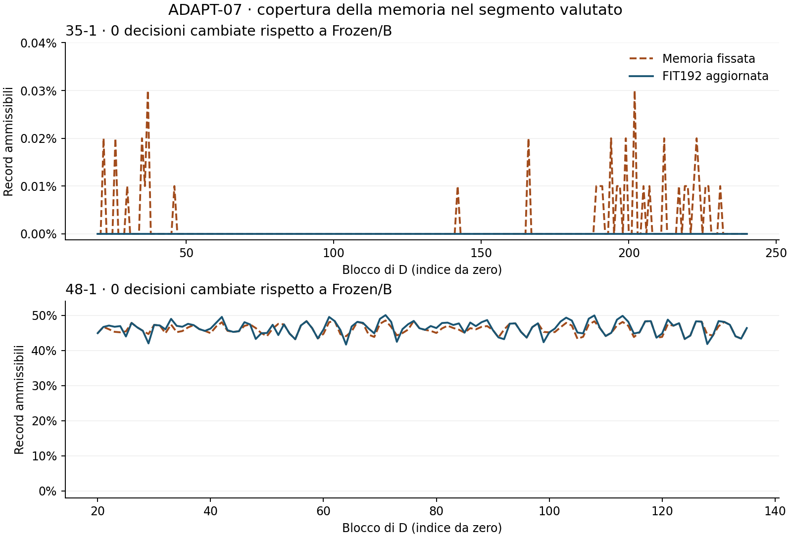

# ADAPT-07 — conferma su catture indipendenti

## Prima coppia e sostituzione

**Esito della prima coppia.** Le due sessioni IoT-23 avevano
periodi non sovrapposti e i relativi log contengono le otto colonne Zeek
richieste. La sessione 48-1 è idonea secondo il preflight. Nella 1-1 la
mancanza di durata e byte di payload lascia troppo pochi record completi
per valutare D dopo il riscaldamento. La prova richiede una coppia idonea,
quindi ci si è fermati prima dei fit, delle calibrazioni e dei replay.

Il [protocollo](PROTOCOL.md), l’[inventario](INVENTORY.md) e il verificatore
sono stati congelati al commit `74439a50cac0f9ce2248ef9ed46e0f797cc1a914`
prima del preflight. Il [rendiconto](PREFLIGHT.json) registra hash, dimensioni,
schema, supporti, tempi e motivi della decisione.

| Sessione | Periodo osservato dai timestamp di inizio, UTC | UID distinti | Righe complete | Record D | Record valutabili dopo il warm-up | Esito |
|---|---|---:|---:|---:|---:|---|
| 1-1 | 9 maggio 2018 15:30 – 14 maggio 2018 07:24 | 1.008.748 | 212.448 | 84.980 | 0 | Bloccata |
| 48-1 | 28 febbraio 2019 18:15 – 1 marzo 2019 04:01 | 3.394.338 | 3.394.337 | 1.357.735 | 1.157.735 | Idonea |

Per la 48-1 i timestamp confermano il **2019** e delimitano i record
disponibili a circa **9 ore e 46 minuti**. Le 24 ore riportate nel catalogo
sono la durata dichiarata dello scenario. Il rendiconto usa gli estremi
osservati nei log. Per entrambe le sessioni ogni UID è univoco. Le colonne
di identificazione e le etichette restano fuori dalla chiave.
[Documentazione del publisher](https://www.stratosphereips.org/datasets-iot23)

Nella 1-1 mancano `duration`, `orig_bytes` e `resp_bytes` nelle stesse
**796.300 righe**, di cui 446.118 benigne e 350.182 malevole. La classe
benigna passa dal 46,52% del log al 10,90% tra le righe complete.
La differenza rende esplicito il limite di rappresentatività del
sottoinsieme con feature osservabili. Nella 48-1 è esclusa una sola
riga e il segmento valutabile contiene 1.131 normali e 1.156.604 record
malevoli. Il requisito si applica al supporto delle classi e al
riscaldamento. La frequenza delle ricorrenze non è stata usata per
selezionare o scartare alcuna sessione.

## Riproduzione del preflight

Scaricare dal publisher soltanto i due log Zeek etichettati e salvarli
fuori da Git come `iot23-1-1.log` e `iot23-48-1.log`. I link puntano
ai singoli log della release pubblica IoT-23 di Garcia, Parmisano
ed Erquiaga, identificata dal DOI `10.5281/zenodo.4743746`.
[Log 1-1](https://mcfp.felk.cvut.cz/publicDatasets/IoT-23-Dataset/IndividualScenarios/CTU-IoT-Malware-Capture-1-1/bro/conn.log.labeled) ·
[Log 48-1](https://mcfp.felk.cvut.cz/publicDatasets/IoT-23-Dataset/IndividualScenarios/CTU-IoT-Malware-Capture-48-1/bro/conn.log.labeled)

Da un checkout del commit congelato, in PowerShell e dalla radice del
clone, indicare la cartella dei due file e un percorso di output nuovo.
L’ambiente verificato è Windows 11 con Python 3.12.7 e NumPy 2.3.5.

```powershell
python adattamento-drift/adapt07_independent_captures/preflight.py --root '<cartella-log>' --out '<cartella-output>/preflight.json'
if ($LASTEXITCODE -ne 2) { throw 'Esito del preflight inatteso' }
```

Il codice 2 è l’esito di idoneità previsto per questa coppia. Il JSON
rigenerato conserva i tempi locali e si confronta sui campi di
provenienza e supporto. Il preflight ha richiesto circa 98 secondi
per entrambi i log, escluso il download.

Il riesame ha ricalcolato i conteggi grezzi, le righe complete e i
supporti A/B/D con un secondo parser a blocchi. I conteggi coincidono
per entrambe le sessioni. Verificati anche gli SHA-256 dei log e delle
fonti del preflight. Passano 29 test mirati, inclusi i 6 del preflight
e i 23 del modulo ADAPT-06I.

## Esito del riesame iniziale

Il [riesame](RIESAME.md) confronta la consegna con la scheda, verifica la
revisione v2 della 1-1 e documenta la 35-1 come candidata da concordare.

Il professore ha poi autorizzato la sostituzione. L’[emendamento](AMENDMENT_35_1.md)
è stato committato prima di acquisire il log completo della 35-1. Il
[preflight della nuova coppia](PREFLIGHT_35_1.json) passa per entrambe
le sessioni con lo stesso warm-up. L’esito originale della 1-1 resta
nel rendiconto sopra.

## Confronto primario sulla coppia emendata

I tre bracci producono le stesse decisioni osservazione per osservazione
in entrambe le sessioni. I denominatori sono quelli di D dopo il warm-up.

| Cattura | Attacchi rilevati / attacchi | Falsi allarmi / benigni | Recall | FPR |
|---|---:|---:|---:|---:|
| 35-1 | 1.163.815 / 1.163.903 | 0 / 1.042.166 | 99,9924% | 0,0000% |
| 48-1 | 1.155.740 / 1.156.604 | 2 / 1.131 | 99,9253% | 0,1768% |

Nella 35-1 la memoria aggiornata non incontra chiavi ammissibili tra
i record valutati. La memoria fissata ne copre 41 e concorda con
Frozen/B. Nella 48-1, la memoria aggiornata copre 537.812 record
su 1.157.735, pari al 46,45%, e restituisce sempre la stessa classe
di Frozen/B. Il criterio preregistrato è insoddisfatto in entrambe
le catture. Il risultato riguarda i record con feature complete:
nella 35-1 sono esclusi 4.432.615 flussi, mentre nella 48-1 il
denominatore benigno è 1.131. Le due sessioni provengono dallo
stesso laboratorio.

[Tabella per cattura e politica](primary/RESULTS.csv) ·
[Rapporto generato](primary/NOTE.md) · [Manifest](primary/MANIFEST.json) ·
[Comandi](PRIMARY_COMMANDS.md)



Le ordinate dei due pannelli hanno scale diverse. La figura è stata
rigenerata da `BLOCKS.csv` e verificata byte per byte nell’ambiente
registrato nei comandi.

Il riesame della nuova coppia ha confermato i supporti A/B/D della 35-1
con una seconda lettura e l’identità della 48-1 con il preflight
originale. I conteggi per cattura si riconciliano con blocchi, tipi e
chiavi. Sono passati 165 test mirati, di cui 19 relativi ad ADAPT-07.

## Archivio locale

`adapt07_primary_c49ed03.zip` misura 217.797 byte e ha SHA-256
`6b77ff75a9eb318eb14d94407c6af1c0ca63e88f8105c5083cc6374960ec6954`.
È conservato in `adattamento-drift/archivio_esterno/adapt07_independent_captures/`
e contiene i prodotti, le inizializzazioni A/B, i manifest, i preflight,
il protocollo, l’emendamento e i comandi. I log di origine sono
disponibili separatamente dal publisher. È stata verificata la
corrispondenza di ogni file interno alla consegna.
