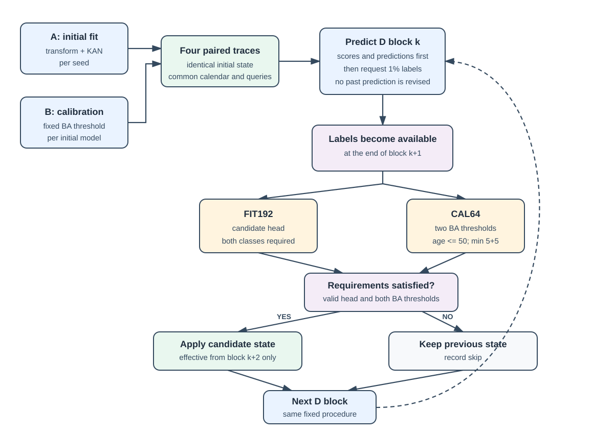
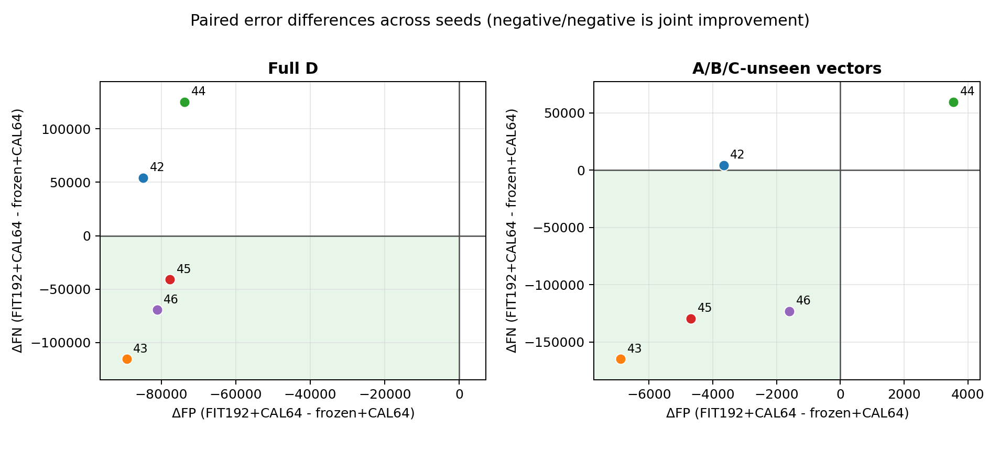

# Draft — Materials and Methods and Results

## 2. Materials and Methods

### 2.1 Data and chronological protocol

We retained eight numerical TON_IoT network inputs from the preceding feature
contract: `duration`, `src_bytes`, `dst_bytes`,
`missed_bytes`, `src_pkts`, `src_ip_bytes`, `dst_pkts`, and `dst_ip_bytes`.
These differ from the harmonised feature space of the parallel benchmark and
are not directly interchangeable. Records were
ordered by `feature_ready_time = ts + duration`, when the complete vector
becomes available. No class rebalancing was applied.

The stream was divided into four non-overlapping intervals (Table 1). A was
used to fit the initial model, B calibrated its threshold, and C supported ADAPT-01--04
development. A covered 2--4 and 23 April 2019, B 24 April, C 25--26 April, and
D 27--29 April. D was accessed only after the protocol and code were fixed.
The primary scope contains all 3,549,973 D records. A supplementary mask marks
2,228,436 records whose vector did not occur in A/B/C. Applied only during
aggregation, it changes neither predictions nor online state and does not
remove repetitions within D.

**Table 1. Compact protocol and four paired evaluation traces.** D contains 354 full
blocks of 10,000 records and a final block of 9,973 records.

| Type | Item | Role or weights | Size or threshold |
|---|---|---|---|
| Data | A | initial transformation and model fitting | 3,956,308 rows |
| Data | B | per-seed initial threshold calibration | 5,681,198 rows |
| Data | C | development of ADAPT-01--04; not replayed in the final evaluation | 9,150,673 rows |
| Data | D | single final chronological evaluation | 3,549,973 rows; 355 blocks |
| Trace | frozen+B | initial weights | fixed threshold calibrated on B |
| Trace | frozen+CAL64 | initial weights | threshold recalibrated on recent CAL64 |
| Trace | FIT192+B | head updated on FIT192 | fixed threshold calibrated on B |
| Trace | FIT192+CAL64 | head updated on FIT192 | threshold recalibrated on recent CAL64 |

### 2.2 Model and compared traces

Each input was transformed as `log1p(max(x,0))` and standardised with the mean
and standard deviation estimated on A. The detector was a single-layer
additive KAN with eight cubic B-spline basis functions per input over the range
observed in A. Its 64 spline coefficients were estimated by logistic regression
(`C=1.0`, `max_iter=1000`) on a seeded 400,000-record A subsample and then
frozen. The score was `b + sum_j g_j f_j(x_j)`, where online adaptation was
restricted to eight gains `g_j` and the intercept `b`. The four traces are
therefore paired configurations of one architecture, separating head and
threshold updates.

For each seed, the transformation and KAN were fitted from scratch on A before
D was read. The threshold denoted by `+B` maximised balanced accuracy on the
whole B interval, using the predefined lower-median tie-break, and then stayed
fixed. `frozen+CAL64` retained the initial weights but recalibrated its
threshold on recent labelled examples with the same objective and tie-break.
`FIT192+B` updated the head while
retaining the B threshold. `FIT192+CAL64` combined the same fitted head with a
recent threshold. Traces with common weights used identical scores.

### 2.3 Causal online procedure

Predictions preceded all labels from their block (Figure 1). A uniform 1%
sample was requested per block; labels requested in *k* became available at
the end of *k+1*, so state changes could affect predictions only from *k+2*.
Past predictions were never recomputed. D labels participated online under the
fixed rule, but D did not select the design or tune parameters.

FIT192 and CAL64 started empty and had capacities of 192 and 64, with target
class quotas of 96/96 and 32/32. A fixed salted SHA-256 rule assigned CAL when
the digest modulo four was zero and FIT otherwise, making the role immutable
for each vector. When full, a memory evicted the oldest example from the class
above quota. FIT192 fitted a candidate logistic head (`C=1.0`,
`max_iter=1000`); CAL64 retained examples no older than 50 blocks and required
at least five from each class. Both classes were also required in FIT192. A
valid head and both thresholds changed atomically for the next block;
otherwise all traces retained their previous state and recorded a skip cause.

**Figure 1.** Initial fitting and calibration precede D. Delayed labels enter
separate fitting and calibration memories, and a valid atomic update can
influence only subsequent blocks.

### 2.4 Evaluation and reproducibility

Seeds 42--46 used the same chronological D stream and paired within-seed
differences. Primary metrics were global FN, FP, recall, and FPR; global
balanced accuracy and mean per-block AUROC were secondary. Undefined
monoclass-block values remained missing, giving denominators of 352/355 for
full D and 350/355 for A/B/C-unseen vectors. Values are mean and sample SD;
the SD is not a confidence interval, and seeds are not independent datasets.

The preregistered comparison was `FIT192+CAL64 - frozen+CAL64`. Its criterion
required no deterioration in either FN or FP, improvement in at least one, and
joint satisfaction of these conditions in at least four of five seeds. Code was frozen at
`ea216914f756433fe69fd825146de5c1e325cbd8`; inputs, command, environment,
outputs, and SHA-256 digests were recorded. The total timer excluded A/B/C
hashing and final summary serialisation but included D hashing and loading,
A/B preparation, five replays, and the five per-seed JSON writes.

## 3. Results

### 3.1 Development on C

ADAPT-01 showed that schedule mattered and updates did not improve every
metric. On C, ADAPT-02 class-aware memory improved AUROC and FPR relative to
FIFO but increased FN. ADAPT-03 changed recall and FP through thresholds while
leaving AUROC unchanged. In ADAPT-04 on C/seed42, FP and FN decreased after
updates; during skips, FP decreased but FN increased. Protocol differences
prevent treating ADAPT-01--04 as one ranking.

### 3.2 Final performance on D

Table 2 reports absolute performance. In the main comparison on full D,
FIT192+CAL64 relative to frozen+CAL64 reduced FP by 81,355.4 on average and
increased recall by 0.286
percentage points, reduced FPR by 26.271 points, increased global balanced
accuracy by 13.279 points, and increased mean per-block AUROC by 0.082329.
However, FN decreased only for seeds 43, 45, and 46. The same three seeds
showed joint FN and FP improvement for A/B/C-unseen vectors; seed 44 worsened
both. The four-of-five criterion was not met.

**Table 2. Absolute results on the two scopes (mean ± sample SD across five
seeds).** FN and FP are counts; recall, FPR, and global BA are percentages.
Mean block AUROC uses 352/355 valid blocks for full D and 350/355 for the
A/B/C-unseen feature-vector subset.

| Scope | Trace | FN | FP | Recall (%) | FPR (%) | Global BA (%) | Mean block AUROC |
|---|---|---:|---:|---:|---:|---:|---:|
| Full D | frozen+B | 2,556,210.8 ± 23,236.3 | 39,136.2 ± 413.1 | 21.112 ± 0.717 | 12.638 ± 0.133 | 54.237 ± 0.329 | 0.853550 ± 0.012193 |
| Full D | frozen+CAL64 | 353,454.0 ± 53,161.4 | 144,730.2 ± 6,318.6 | 89.092 ± 1.641 | 46.736 ± 2.040 | 71.178 ± 1.733 | 0.853550 ± 0.012193 |
| Full D | FIT192+B | 2,954,958.6 ± 190,791.8 | 2,737.2 ± 3,083.7 | 8.806 ± 5.888 | 0.884 ± 0.996 | 53.961 ± 3.233 | 0.935879 ± 0.003423 |
| Full D | FIT192+CAL64 | 344,198.8 ± 49,694.1 | 63,374.8 ± 6,542.7 | 89.378 ± 1.534 | 20.465 ± 2.113 | 84.456 ± 1.146 | 0.935879 ± 0.003423 |
| A/B/C-unseen vectors | frozen+B | 2,032,985.0 ± 23,235.3 | 6,887.2 ± 260.8 | 3.120 ± 1.107 | 5.299 ± 0.201 | 48.911 ± 0.518 | 0.793388 ± 0.022893 |
| A/B/C-unseen vectors | frozen+CAL64 | 255,423.0 ± 63,982.9 | 44,176.4 ± 4,223.8 | 87.828 ± 3.049 | 33.987 ± 3.250 | 76.921 ± 2.819 | 0.793388 ± 0.022893 |
| A/B/C-unseen vectors | FIT192+B | 2,067,609.4 ± 5,672.1 | 917.6 ± 228.5 | 1.470 ± 0.270 | 0.706 ± 0.176 | 50.382 ± 0.190 | 0.905100 ± 0.004932 |
| A/B/C-unseen vectors | FIT192+CAL64 | 184,594.4 ± 38,339.5 | 41,521.2 ± 1,447.6 | 91.203 ± 1.827 | 31.944 ± 1.114 | 79.630 ± 1.012 | 0.905100 ± 0.004932 |

At common adapted weights, replacing the B-calibrated threshold with CAL64
reduced FN by 2.61 million attack-labelled records but added 60,638 FP on full
D; AUROC was unchanged because scores were
identical. Relative to frozen+B, FIT192+CAL64 reduced FN by 2.21 million
attack-labelled records but added 24,239 FP. Among A/B/C-unseen vectors its FPR
remained 31.944%, and 96.7% of the aggregate
FP reduction occurred among vectors seen in A/B/C. This decomposition is
post-hoc and does not establish that repeated vectors caused the reduction.

**Figure 2.** Per-seed differences for `FIT192+CAL64 - frozen+CAL64`.
Negative values on both axes indicate joint improvement. Full D is the primary
scope; A/B/C-unseen vectors are a supplementary aggregation of the same
predictions.

### 3.3 Temporal behaviour and cost

On C, ADAPT-04 had 423 consecutive skip-associated blocks in the interval 242--664,
where FIT192+CAL64 accumulated 807 more FP and 219,608 more FN than
frozen+CAL64. On D, all 44 skips occurred at the beginning of a seed replay;
none occurred after the first successful update. Updates/skips were 337/17,
351/3, 347/7, 341/13, and 350/4 for seeds 42--46. This contrast localises an
unfavourable period on C but cannot by itself identify its cause because the
two streams differ in length and composition.

The complete final-evaluation command required 1,234.388 s under the documented
timer boundary, including D hashing/loading, A/B preparation and output writes.
Per-seed replay times ranged from 48.622 to 59.837 s; online head fitting took
9.630--10.672 s per seed in total, while each threshold-calibration total was
below 0.11 s. These components are included in replay time. The final update
decision had no later D block to influence, and
the last 99 requested labels remained pending at stream end.

### Points for supervisor review

- Add the canonical TON_IoT and prior feature-contract citations when the
  literature section is assembled.
- Decide whether the 96.7% post-hoc decomposition belongs in Results or later
  in the Discussion.
- Decide whether the C temporal figure should be added in a later revision;
  it is not presented here as a D result.
